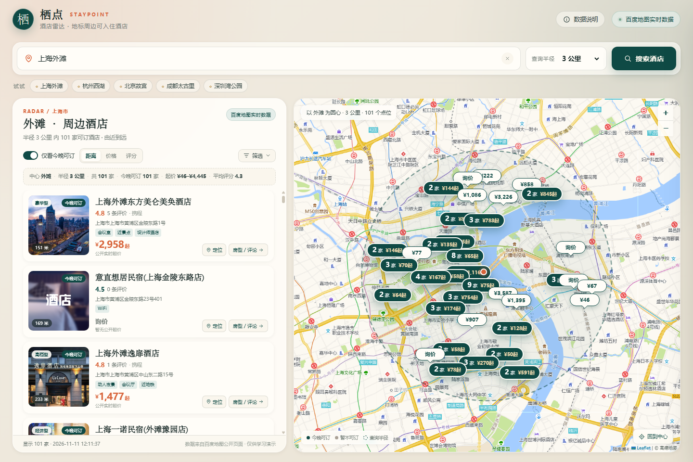

# 栖点 · STAYPOINT 酒店雷达

一个本地运行的酒店查询 Web 应用：输入地区 / 地标，选择查询半径，在范围内查找可入住酒店，查看价格、真实房型词、评分、设施、政策、住客评论与实拍图片。

数据来自百度地图公开页面，无需申请 API Key；后端做归一化、图片代理与离线兜底，前端为中文 GUI。百度桌面搜索接口偶尔会触发人机验证，程序会自动改用移动版搜索结果页继续获取实时数据。



## 功能

- **地标搜索与联想**：支持「上海外滩」「杭州西湖」「北京故宫」「成都太古里」等地区 / 地标；也支持「上城区」「西湖区」「浦东新区」这类区县名（区县没有直接 POI 时，自动用区县政府作为区域中心）；输入时给出百度真实 POI 建议。
- **半径筛选**：500 m / 1 km / 2 km / 3 km / 5 km / 10 km（服务端限制 300–20000 m）。
- **范围完整抓取**：以地标为圆心构造矩形检索范围，按「酒店 / 宾馆 / 民宿 / 公寓 / 客栈 / 旅社」多类关键词并行翻页，再按真实距离过滤，10 公里这样的大半径也能覆盖到外圈酒店，不会只显示中心一小簇。
- **只看今晚可订**：根据百度返回的 `pc_bookable` / `pc_fullroom` 过滤。
- **细筛**：价格区间、酒店档次（经济 / 舒适 / 高档 / 豪华 / 五星）、最低评分、最低评价数、设施标签（近地铁、免费停车、近景点、家庭房、会议室等）与名称 / 品牌关键词；支持多选、单项移除和清除全部。筛选后列表、统计、地图点位和 URL 同步更新。
- **地图联动与卡片定位**：Leaflet + 高德瓦片；价格气泡按价位聚合，避免重叠；绘制查询中心与半径圆；点击气泡直接打开详情。每张酒店卡片的「定位」按钮会让地图飞到酒店位置并展开信息气泡，移动端会自动滚动到地图，不会误开详情。
- **详情抽屉**：封面图集、星级 / 评分 / 评论数、距离、起价、房型、设施、入住政策、简介、住客评论与实拍图。
- **评论与图片展开**：评论区默认展示精选评论，可展开全部；图片支持灯箱、左右切换、键盘 Esc。
- **排序**：距离、价格、评分、评论数。
- **实时无缓存**：点一次「搜索酒店」就重新向百度请求一次，进程内不再保留搜索结果缓存，价格和可订状态每次都是最新的。
- **离线兜底**：实时数据源均不可用时，读取 `data/offline/hotels.json`（含上海外滩 / 杭州西湖 / 北京故宫 / 成都太古里样本）。查询不在这 4 个地标内会明确提示没有离线数据，不会再错误显示其他城市的结果。
- **链接可分享**：搜索条件写入 URL（`?q=上海外滩&radius=3000&bookable=1`），打开带 `q` 的链接会自动查询；不带 `q` 时停在欢迎页，不会默认搜索某个地标。

更多截图见 [`screenshots/home.png`](screenshots/home.png)、[`hangzhou-10km.png`](screenshots/hangzhou-10km.png)（杭州站 10 公里，点位铺满整个查询半径）、[`locate-far.png`](screenshots/locate-far.png)（定位 10 公里外的酒店）、[`boot-empty.png`](screenshots/boot-empty.png)（打开页面停在欢迎页）、[`locate.png`](screenshots/locate.png)、[`locate-mobile.png`](screenshots/locate-mobile.png)、[`filters.png`](screenshots/filters.png)、[`filters-panel.png`](screenshots/filters-panel.png)、[`filters-mobile.png`](screenshots/filters-mobile.png)、[`detail.png`](screenshots/detail.png)、[`reviews.png`](screenshots/reviews.png)、[`lightbox.png`](screenshots/lightbox.png)、[`suggest.png`](screenshots/suggest.png)、[`hangzhou.png`](screenshots/hangzhou.png)、[`shangcheng-live.png`](screenshots/shangcheng-live.png)（上城区 10 公里实时查询）。

## 快速开始

### Windows（推荐）

双击项目根目录下的 **`启动.bat`**。

脚本会打开一个保持运行的命令窗口，检查 Python / 依赖、启动服务并自动打开浏览器；窗口内会显示启动信息和 Flask 访问日志：

```text
http://127.0.0.1:8765/
```

**请保持这个命令窗口运行**：关闭窗口会连同 Python 服务一起结束。也可以先在窗口按 `Ctrl+C` 停止服务，再按任意键关闭窗口。如果窗口提示 8765 端口被占用，说明已经有一个 STAYPOINT 窗口在运行，请先关闭旧窗口。

### 手动启动

要求 Python 3.10+（本机已在 Python 3.14 验证）。

```bat
cd /d G:\workdir\staypoint
python -m pip install -r requirements.txt
python -u app.py --port 8765 --open
```

如果 8765 端口被占用：

```bat
python app.py --port 8766 --open
```

## 使用说明

1. 在顶部输入框输入地区 / 地标（如 `上海外滩`），从联想列表选择或直接回车。
2. 选择查询半径和「仅看今晚可订」，点击「搜索酒店」。
3. 左侧卡片按距离 / 价格 / 评分 / 评论数排序；右侧地图显示价格气泡与查询半径。每张卡片右下角的「定位」按钮可让地图飞到该酒店并弹出信息气泡（移动端会自动滚动到地图）。
4. 点击「筛选」展开细筛面板：价格区间、酒店档次、最低评分、最低评价数、设施与名称关键词；点击「应用筛选」后，列表、统计、地图点位同步刷新，条件保留在 URL 与本地。点击已筛选 chip 上的 × 可单项移除，或点「清除全部」。
5. 点击卡片或地图气泡，右侧打开酒店详情抽屉；抽屉内也可点「地图定位」关闭详情并回到地图：
   - 「房型」查看实时在售房型与参考套房；
   - 「住客评论」可展开全部评论；
   - 点击图集图片进入灯箱，`←` / `→` 切换，`Esc` 关闭。
6. 再次搜索其他地标即可；查询条件会写入 URL，刷新或分享链接即可复现。

## 数据来源与重要说明

- 酒店名称、地址、电话、价格、评分、评论数、实拍图、部分房型词均来自**百度地图公开页面**的 POI 搜索结果，仅供个人学习与演示。
- **实时数据获取**：优先请求百度地图桌面版 `qt=s` JSON 接口（带 `b=` 矩形范围 + 深翻页，单次搜索会按 6 类关键词并行抓取多页）；桌面接口被要求人机验证或返回异常时，自动退回移动版搜索结果页（`/mobile/webapp/place/list`）继续获取。两者都失败时才进入离线兜底。
- **实时无缓存**：服务端不缓存搜索结果，每次点击搜索都会重新抓取，因此价格与房态是当次的最新数据（代价是每次搜索需要几秒钟）。
- **离线兜底范围**：只覆盖上海外滩、杭州西湖、北京故宫、成都太古里 4 个内置地标；查询其他地点会明确提示离线样例不覆盖，请稍后重试实时查询。
- **价格与房态**为查询时百度页面展示的参考数据，会随时间变化；本工具不提供预订，最终以酒店官方渠道为准。
- **房型说明**：
  - 每店保留 1 个**实时在售**房型：价格取百度返回的 `pc_realtime_price` / `for_se_price`，房型名优先取百度返回的房型词（如大床房、双床房）；百度没有完整房价日历，面积与床型为展示辅助信息；
  - 另外 3 个房型是根据酒店星级、价格与房型词生成的**参考套房**，界面明确标注「参考房型，实际以酒店为准」，不是酒店官方报价。
- **评论**：每店最多展示百度返回的约 5 条真实评论；评论正文与用户名为百度返回的 Base64 编码数据，后端已解码。评论图片来自携程 CDN。
- **图片**：通过后端 `/api/image` 代理下载并缓存到 `data/image_cache/`，前端只访问本地地址；域名有白名单，未命中白名单返回 403。
- **坐标**：百度返回的是 BD-09 墨卡托坐标（×100），后端 `/100` 后经 BD-09 → GCJ-02 转换，再用于高德瓦片；距离按 GCJ-02 坐标的 haversine 计算。
- **暂不支持境外**：百度对部分境外地标返回的坐标为空，因此海外查询没有可靠结果。
- 使用本工具请遵守百度地图的服务条款与 robots 规则，不要高频抓取。

## API

| 方法 | 路径 | 说明 |
| --- | --- | --- |
| GET | `/api/health` | 健康检查；`offline_snapshot` 表示离线快照是否存在 |
| GET | `/api/config` | 半径选项、示例、免责声明 |
| GET | `/api/suggest?q=外滩` | 地标联想；可带可选 `city_code` |
| GET | `/api/search?q=上海外滩&radius=3000&bookable=1&sort=distance` | 酒店搜索；`bookable=0` 表示包含不可订 |
| GET | `/api/image?u=<图片地址>` | 图片代理（域名白名单 + 磁盘缓存） |

`/api/search` 的细筛参数（均可选）：

| 参数 | 说明 |
| --- | --- |
| `price_min` / `price_max` | 每晚起价区间；设置后排除无公开价格的酒店 |
| `levels` | 酒店档次，逗号分隔，如 `豪华型,五星级` |
| `min_rating` | 最低评分，如 `4.5` |
| `min_reviews` | 最低评价数 |
| `tags` | 设施 / 体验标签，逗号分隔，任一命中即可 |
| `kw` | 名称 / 品牌关键词 |

示例：

```bash
curl "http://127.0.0.1:8765/api/search?q=%E4%B8%8A%E6%B5%B7%E5%A4%96%E6%BB%A9&radius=3000&bookable=1&sort=distance&price_min=300&price_max=2000&levels=%E8%B1%AA%E5%8D%8E%E5%9E%8B&min_rating=4.5&tags=%E8%BF%91%E5%9C%B0%E9%93%81"
```

`/api/search` 主要响应字段：

```json
{
  "ok": true,
  "query": "上海外滩",
  "anchor": {"name": "外滩", "city": "上海市", "city_code": 289, "lng": 121.4927, "lat": 31.2328, "is_area_center": false},
  "radius_m": 3000,
  "hotels": [],
  "stats": {"count": 65, "returned": 65, "total_found": 65, "truncated": false, "available": 65, "min_price": 60, "max_price": 4156, "avg_rating": 4.5},
  "filters": {"price_min": 0, "price_max": 0, "levels": [], "min_rating": 0, "min_reviews": 0, "tags": [], "kw": ""},
  "filter_count": 0,
  "source": "live",
  "source_label": "百度地图实时数据",
  "warning": null,
  "generated_at": "2026-11-09 11:30:55",
  "elapsed_ms": 2280
}
```

其中 `stats.count` / `total_found` 是半径内符合条件的完整酒店数，`stats.returned` 是本次实际返回的条数（界面默认单次最多展示 300 条，超过才截断），`truncated` 表示结果是否被截断；`available` 按完整列表统计。

## 项目结构

```text
staypoint/
├─ app.py                     Flask 入口与 API 路由
├─ 启动.bat                   Windows 一键启动
├─ requirements.txt
├─ backend/
│  ├─ baidu.py                百度 POI 搜索、详情归一化、联想、房型/评论生成
│  ├─ coords.py               BD09MC / GCJ-02 / WGS84 坐标转换与距离
│  ├─ hotel_service.py        搜索编排、排序、离线兜底
│  └─ images.py               图片白名单下载与磁盘缓存
├─ static/
│  ├─ index.html              中文 GUI
│  ├─ app.js                  搜索、联想、渲染、地图、抽屉、灯箱
│  ├─ style.css               设计系统与响应式样式
│  ├─ img/                    favicon、占位图
│  └─ vendor/                 Leaflet 1.9.4 + markercluster 1.5.3（本地化）
├─ data/
│  ├─ offline/hotels.json     离线兜底快照（4 个地标）
│  └─ image_cache/            图片缓存（运行时生成）
├─ tools/
│  ├─ fetch_offline.py        重新生成离线快照
│  ├─ test_coords.py          坐标转换自检
│  ├─ test_service.py         搜索链路自检
│  ├─ cdp_check.mjs           （可选）CDP 端到端浏览器检查
│  ├─ cdp_verify.mjs          （可选）首页/大半径/定位专项检查
│  └─ cdp_eval.mjs            （可选）CDP 页面求值/截图
└─ screenshots/               交付截图
```

## 开发与自检

```bat
:: 坐标转换
python tools\test_coords.py

:: 搜索链路（真实网络）
python tools\test_service.py

:: 重新生成离线快照（会覆盖 data/offline/hotels.json）
python tools\fetch_offline.py
```

浏览器端到端检查（可选，需要以 `--remote-debugging-port=9222` 启动 headless Chrome，并让 Flask 跑在 8765）：

```bat
node tools\cdp_check.mjs
```

## 已知限制

- 百度地图页面结构或接口参数可能变化；若桌面与移动版实时数据都不可用，应用只会对 4 个内置地标展示离线快照，其他查询会明确报错，不会显示错误城市的结果。
- 大半径（5–10 公里）需要多次请求百度页面，单次搜索通常 4–8 秒；百度偶发 403 时会自动重试并跳过个别失败页，结果数量会略有波动。
- 地图瓦片来自高德；瓦片不可达时地图会降级为自绘雷达底图，列表与详情不受影响。
- 没有数据库和用户系统；搜索结果不做任何缓存，每次搜索都实时请求百度。
- 图片首次加载需联网，之后走本地缓存。
- 本项目仅用于学习与作品演示，不提供在线预订或支付能力。
